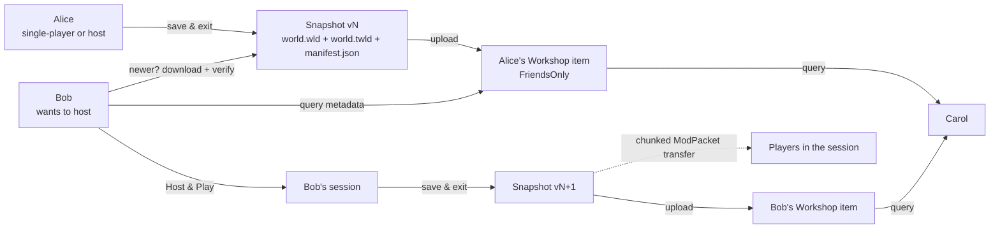

# Shared Worlds

A tModLoader mod that lets a group of friends share **one** Terraria world across different accounts and different machines — without a server, VPS, NAS, cloud drive, or always-on host.

Steam already handles multiplayer (Host & Play, Steam friends, lobbies, P2P). Shared Worlds solves the part Steam does not: **where the newest world file lives** and **how the next host gets it**.

> Status: **0.1.1, early development.** The snapshot, versioning, fork-detection, main-menu, in-game panel, Host & Play, and single-account Workshop create/upload/query/download paths are implemented and tested. Friends-only access from a **second** Steam account and the Steam overlay EULA flow still need a two-account manual check. See [Testing](#testing).

---

## The problem

Terraria cannot merge two diverged `.wld` files. If Alice plays alone and then goes offline, only Alice's machine has the newest world. Her friends cannot host it. Steam Cloud is per-account and cannot be shared; Steam Remote Play requires the host to stay online.

Steam Workshop is the only always-on, Valve-hosted storage available inside the constraints, but **only the owner of a Workshop item can update it**. Sharing one Steam login is not acceptable.

## How it works

Each Steam account gets **its own friends-only Workshop item per shared world**. Every item has exactly one writer. The group's newest version is the highest version across all those items, with hash/parent-chain fork detection.



ASCII version:

```
             save & exit                          save & exit
Alice ───────────────────► snapshot vN ──upload──► Alice's item (friends-only)
                                                         ▲
                                                         │ query metadata
Bob ── sync/download ◄───────────────────────────────────┘
  │
  └── Host & Play ──► session ──► snapshot vN+1 ──upload──► Bob's item
                            │
                            └── peer transfer to connected players
```

### Per-account items, not one shared item

Steam's API has no "add an uploader" permission. Contributors on a Workshop page are credit only. So every account writes to its own item, and the manifest records:

```
steamId -> publishedFileId
```

The newest version is chosen by version number, but **never installed purely because the number is higher**. The mod verifies the content hash, reads the full manifest history, and only fast-forwards if the remote version descends from the local one. If two branches share a parent, it shows a fork and asks which to keep. The losing branch stays in local backups.

### What is stored

A snapshot folder contains:

```
manifest.json
world.wld
world.twld
```

- `world.wld` + `world.twld` are exactly what tModLoader saves.
- `manifest.json` stores `worldId`, integer version, content hash, parent hash, last host Steam ID, timestamp, mod list, participant item IDs, and version history.
- Content hash = `SHA256( SHA256(world.wld) || SHA256(world.twld) )`.
- The `.twld` also stores the stable `SharedWorldId`, so a world can identify itself if the local registry is lost.

Workshop item **metadata** (max 5000 bytes) stores a compact copy of the version header so the mod can query all participant items **without downloading them**. Only the winning snapshot is downloaded.

---

## Requirements

- tModLoader **1.4.4**, stable **2026.09.x** (built/tested against **2026.09.3.1**).
- Terraria + tModLoader launched through **Steam**. Workshop storage needs the Steam client API; GOG/offline mode falls back to local + peer transfer.
- The participating accounts must be **Steam friends**. Workshop items are `FriendsOnly`; private items cannot be read by anyone else.
- The host must be online while hosting. There is no dedicated server.
- Windows, Linux, or macOS. The mod is pure managed C#.

---

## Install

### From the Steam Workshop (after release)

Subscribe to **Shared Worlds** in the tModLoader Workshop, enable it in **Workshop → Manage Mods**, and reload.

### From source (development)

```bash
git clone <repo-url> SharedWorlds
cd SharedWorlds/src/SharedWorlds
cp Local.props.example Local.props
# edit Local.props: point tMLSteamPath at your tModLoader install (trailing slash)
dotnet build -c Release
```

The build copies `SharedWorlds.tmod` into your tModLoader `Mods` folder. Enable it and reload.

Build requirements: .NET 8 SDK. The project imports `tMLMod.targets` from the tModLoader installation, so it compiles against exactly the installed tModLoader and Steamworks.NET.

---

## Usage

### 1. Register a world

1. Launch tModLoader, open **Shared Worlds** on the main menu (or press **F9**).
2. Choose **Register world** and pick a **local** world. Steam Cloud worlds are not supported yet.
3. The world is registered under a new stable GUID. No Workshop item exists until the first publish.

### 2. First publish

Either:

- **Host** the world from the Shared Worlds screen. Behind the scenes this runs the normal Host & Play flow with `Lobby | FriendsCanJoin`. When the session ends, the server process saves the world and uploads snapshot v1 to your own friends-only Workshop item.
- Or play it in single-player; Save & Exit triggers the same snapshot/upload.

The first upload may ask you to accept the **Steam Workshop Legal Agreement**. The item is kept `FriendsOnly`. It is **not a mod**; do not subscribe to it as a mod.

### 3. Invite a friend

Open **Info** on the world and use **Copy invite** (available once your Workshop item exists). Send the `SW1...` code. Your friend imports it with **Import invite**.

Invite codes contain the world ID, owner Steam ID, owner Workshop item ID, and world name. They do not contain credentials.

### 4. A friend hosts

1. The friend opens **Shared Worlds**, selects the world and presses **Host**.
2. The mod queries all known participant items, downloads the newest verified snapshot if needed, and starts **Host & Play**.
   Use this screen (or the in-game F9 panel) rather than the normal Host & Play button: the normal button does not run the pre-host sync.
3. If a fork is detected, hosting is refused until the group chooses a version in **Info → Use remote** (or keeps the local branch).
4. When the session ends, the friend's own Workshop item receives vN+1. The original creator does not need to be online.

### 5. Open to friends (single-player → multiplayer)

In-game, press **F9**, then **Open to friends**. The mod:

1. saves the world,
2. returns to the title screen,
3. automatically starts Host & Play for the same world with friends-only lobby visibility.

This is a save/reload flow, not a live conversion. Host & Play in Terraria 1.4.4 is a separate server process; a true in-place conversion is not realistic.

### 6. Sync during a session

The in-game **F9** panel has **Sync & publish**. It asks the server to save the world, publish a snapshot to the host's Workshop item, and send the same snapshot to every connected player in verified chunks. The host can keep playing; quitting is never blocked by a slow client.

---

## What is implemented

- Per-account friends-only Workshop items with owner-only updates.
- Compact 5000-byte metadata headers + full content manifests.
- SHA-256 content verification before any world file is swapped.
- Local backups before every install, plus snapshot/backup pruning.
- Version DAG: fast-forward detection and explicit fork detection.
- Fork UI with a two-click "Use remote" choice; the losing branch is backed up.
- Local registry recovery from the `SharedWorldId` stored in `.twld`.
- Discovery of a participant's item via their published Workshop items (handles "joined before creating an item" and recreated items).
- Main-menu screen plus F9 keybind; in-game panel.
- "Open to friends" save → title → Host & Play.
- Chunked peer transfer over `ModPacket` (16 KB chunks, zip, transport hash, final snapshot hash, ACKs).
- Pending upload queue with retry.
- Config: auto-upload, timeouts, backup/history counts, menu button, peer transfer, verbose logging.
- Unit tests for version graph, invite codes, and hashing.

## Known limitations

- **Owner-only writes are a Steam constraint.** The per-account item model is the workaround, not an accident.
- **Friendship is part of storage access.** If you unfriend an owner, you lose access to that owner's latest item. Keep more than one participant up to date.
- **Workshop propagation delay.** A just-uploaded version may take a short time to appear in other accounts' queries. The mod retries and reports "uploaded, waiting for Steam". It never swaps in unverified content.
- **A host must be online to host.** The mod removes the need for the *original creator* or an always-on server; it cannot remove the need for *some* player to be online during a session.
- **Use the Shared Worlds Host button.** The normal Host & Play button bypasses the pre-host Workshop check. A load-time warning and fork detection still protect you, but the intended path checks first.
- **No Steam Cloud worlds** in 0.1.x. Move the world to local storage first.
- **No live single-player → multiplayer conversion.** Host & Play is a separate process.
- **No hard "wait for everyone" quit gate.** Peer transfer is best-effort; the Workshop upload is the durability guarantee.
- **Workshop items are policy-sensitive.** They live in the tModLoader Workshop but are not mods. They are friends-only, clearly labelled, and contain no executable content. If Valve/tModLoader removes them, the mod falls back to peer transfer and local copied snapshots.
- **tModLoader updates can break the private Host & Play call.** It is isolated with a fallback to the normal Host & Play screen.
- **64 MB snapshot cap** (uncompressed). Normal worlds are ~2–15 MB; the cap is a safety limit.

---

## Troubleshooting

**"Steam client API is not available"**
Start tModLoader through Steam, not by running the executable directly. GOG/offline mode cannot use Workshop storage; local snapshots and peer transfer still work.

**"You are not Steam friends with …"**
The owner's item is friends-only. Add each other on Steam. The error names the account.

**Upload says pending**
The snapshot is safe locally. Open Shared Worlds → Info → **Publish pending**, or wait until the next save. Check the tModLoader log for the Steam error. If Steam needs the Workshop Legal Agreement, the world shows **EULA needed**; open **Info** and use **Accept Workshop EULA**, accept the overlay prompt once, then **Publish pending**. The server process cannot show the overlay, so accept it on the host client launched through Steam. The general **Steam Subscriber Agreement** page is not the same agreement; the page title must say **Steam Workshop Legal Agreement**.

**"Downloaded snapshot does not match the queried version metadata"**
Steam has not finished propagating the update, or an item was changed mid-query. Retry in a minute. The mod refuses to install mismatched content.

**Fork detected**
Two branches were created from the same version (for example, two people hosted from the same copy). Open **Info**, inspect both heads, and choose **Use remote** or keep local. The losing branch is backed up under `SharedWorlds/backups/<worldId>/`.

**World not found after registering**
Make sure the world is local (not Steam Cloud) and lives in tModLoader's `Worlds` folder. The registry is at `SharedWorlds/registry.json` inside the tModLoader save directory.

**"Host & Play automatic launch is not available"**
The private tModLoader launcher changed. The mod opens the normal **Host & Play** screen with the world selected; press Host there. Please report the tModLoader version.

**Where are my files?**
- Registry, snapshots, backups, temp: `<tModLoader save dir>/SharedWorlds/`
- On Linux: `~/.local/share/Terraria/tModLoader/SharedWorlds/`
- On Windows: `Documents/My Games/Terraria/tModLoader/SharedWorlds/`

**Logs**
`tModLoader-Logs/client.log` / `server.log`. Search for `[SharedWorlds]`.

---

## Testing

Automated:

```bash
cd tests/SharedWorlds.Tests
dotnet run -c Release
```

Covers linear history, fast-forward, forks, missing ancestry, invite round-trips (including Unicode), and content hashes.

Server smoke test (Linux):

```bash
# Use a throwaway save directory and a copy of a world.
dotnet tModLoader.dll -server \
  -savedirectory /tmp/sw-test \
  -modpath /tmp/sw-test/Mods \
  -world /tmp/sw-test/Worlds/Test.wld
```

The log should show the mod loading, a snapshot being built after Save/Exit, and no exceptions.

**Single-account verification (2026-11-20):** registered a world, started Host & Play, saved on server shutdown, created a temporary Workshop item, published v1/v2 as friends-only, queried it back, downloaded it into a fresh save, verified the hashes, and fast-forwarded to v2. The main-menu button, world picker, sync, detail, in-game panel, and Host & Play launch were exercised through the real UI.

**Still needs a second Steam account:** friends-only visibility/query/download, the Steam overlay EULA prompt, and peer transfer to a non-host client. Those are the remaining release gates.

---

## Repository layout

```
src/SharedWorlds/        the mod
  Core/                  registry, manifest, hashing, Steam wrapper, version graph
  Net/                   ModPacket protocol + peer transfer
  UI/                    main menu, in-game panel, fork detail
tests/                   pure-logic test harness
docs/                    research, decisions, GitHub Pages site
.github/workflows/       build, release, pages
```

## Contributing

Read `docs/RESEARCH.md` and `docs/DECISIONS.md` first. Keep Steam calls behind `WorkshopService`, keep file writes inside the tModLoader save directory, and never auto-overwrite a diverged world.

## License

MIT. See `LICENSE`.

## Disclaimer

Terraria and tModLoader are the property of their respective owners. This is an unofficial fan project. Workshop items created by the mod are private shared-world storage, not mods.
