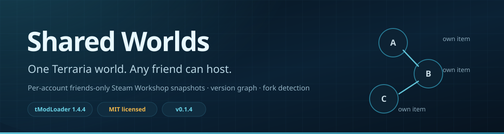
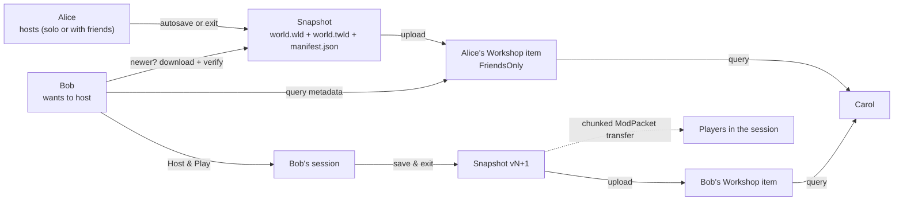

<p align="center">
  
</p>

<p align="center">
  <a href="https://github.com/Hiyzta/SharedWorlds/actions/workflows/build.yml"></a>
  <a href="https://github.com/Hiyzta/SharedWorlds/releases"></a>
  <a href="LICENSE"></a>
  
  <a href="https://hiyzta.github.io/SharedWorlds/"></a>
</p>

# Shared Worlds

A tModLoader mod that lets a group of friends share **one** Terraria world across different accounts and different machines — without a server, VPS, NAS, cloud drive, or always-on host.

Steam already handles multiplayer (Host & Play, Steam friends, lobbies, P2P). Shared Worlds solves the part Steam does not: **where the newest world file lives** and **how the next host gets it**.

> Status: **0.2.0, early development.** The real multiplayer-menu Play screen, live host advertisement, 10-minute autosave uploads, timestamp-first history and host-left recovery are implemented. Friends-only access from a **second** Steam account and peer transfer to a non-host client remain manual release gates. See [Testing](#testing).

| | |
|---|---|
| **Storage** | Per-account, friends-only Steam Workshop items |
| **Snapshot** | `world.wld` + `world.twld` + `manifest.json` |
| **Identity** | `SHA256(SHA256(wld) || SHA256(twld))` + parent chain |
| **Conflict rule** | Fast-forward only; forks are explicit user choices |
| **Backups** | Current world backed up before every install/resolve |
| **No backend** | Only local files + the Steam client |

---

## The problem

Terraria cannot merge two diverged `.wld` files. If Alice plays alone and then goes offline, only Alice's machine has the newest world. Her friends cannot host it. Steam Cloud is per-account and cannot be shared; Steam Remote Play requires the host to stay online.

Steam Workshop is the only always-on, Valve-hosted storage available inside the constraints, but **only the owner of a Workshop item can update it**. Sharing one Steam login is not acceptable.

## How it works

Each Steam account gets **its own friends-only Workshop item per shared world**. Every item has exactly one writer. The group's newest snapshot is selected by content hash and parent-chain ancestry; the integer version is internal bookkeeping.



ASCII version:

```
             save & exit                          save & exit
Alice ───────────────────► snapshot vN ──upload──► Alice's item (friends-only)
                                                         ▲
                                                         │ query metadata
Bob ── sync/download ◄───────────────────────────────────┘
  │
  └── Host & Play ──► session ──► snapshot vN+1 ──upload──► Bob's item
                            │
                            └── peer transfer to connected players
```

### Per-account items, not one shared item

Steam's API has no "add an uploader" permission. Contributors on a Workshop page are credit only. So every account writes to its own item, and the manifest records:

```
steamId -> publishedFileId
```

The newest snapshot is never installed purely because its version number is higher. The mod verifies the content hash, reads the full manifest history, and only fast-forwards if the remote version descends from the local one. If two branches share a parent, it shows a fork and asks which to keep. The losing branch stays in local backups.

### What is stored

A snapshot folder contains:

```
manifest.json
world.wld
world.twld
```

- `world.wld` + `world.twld` are exactly what tModLoader saves.
- `manifest.json` stores `worldId`, integer version, content hash, parent hash, last host Steam ID, timestamp, mod list, participant item IDs, and version history.
- Content hash = `SHA256( SHA256(world.wld) || SHA256(world.twld) )`.
- The `.twld` also stores the stable `SharedWorldId`, so a world can identify itself if the local registry is lost.

Workshop item **metadata** (max 5000 bytes) stores a compact copy of the version header so the mod can query all participant items **without downloading them**. Only the winning snapshot is downloaded.

### When a snapshot is built and uploaded

The snapshot is built on the **authoritative side**, after Terraria has saved the world:

- **Every Shared Worlds autosave** (default 10 minutes) while a Host & Play server is live. The same per-account Workshop item is updated, never duplicated.
- The Host & Play server shutting down after its last player leaves.
- A Steam-enabled server process saving and exiting.

Registered shared worlds **cannot be opened from the vanilla single-player world list**: the row is dimmed like a Journey-mode mismatch and clicking Play opens the same rejection menu, pointing at the Play Shared Worlds screen. One hosted session at a time is how the mod guarantees a single writer and prevents silent offline forks.

On world load, the mod only hashes the world and checks metadata; a newer remote snapshot produces a warning, not an automatic swap. A multiplayer client never builds an authoritative snapshot, but it receives the host's live autosave through peer transfer so it can take over immediately.

If upload is enabled, the registry is marked **pending first**, then the snapshot is updated on **this account's own item**. The exit upload runs while the menu pumps Steam callbacks; a server shutdown waits with a callback-pumping helper thread. If the process exits or Steam is offline, the pending snapshot is retried on the next save/unload, the next autosave, or from **Publish pending**.

### What can go wrong

| Situation | What the mod does |
|---|---|
| Crash/power loss before a save/unload | No snapshot from that session. If Terraria autosaved, the next load records it as a local head; the next normal exit can publish it. |
| Upload fails/times out/goes offline | Snapshot stays local and pending; friends keep the previous published version. |
| Game quits immediately after returning to title | Pending was written before the upload, so it is retried later. |
| First publish needs the Steam Workshop Legal Agreement | Item can be uploaded but stays pending/hidden until the owner accepts both Steam agreements. The mod only shows **EULA needed**; it does not open the overlay. |
| Two hosts from the same version | Two heads; fork detected. Nothing is auto-merged or overwritten. |
| Host starts from an old copy | Parent/hash check exposes the branch as a fork even if its version number is higher. |
| World is over 64 MB uncompressed | Snapshot build fails; local world is untouched. |
| Participant item deleted/banned | Treated as missing; other items and local copies remain usable. |
| Not Steam friends with an item owner | Friends-only item is inaccessible; the mod warns. |
| Local world edited/restored outside the mod | Recorded as a new local head with the previous hash as parent; can become a branch. |

More detail: [docs/EDGE-CASES.md](docs/EDGE-CASES.md).

---

## Requirements

- tModLoader **1.4.4**, stable **2026.09.x** (built/tested against **2026.09.3.1**).
- Terraria + tModLoader launched through **Steam**. Workshop storage needs the Steam client API; GOG/offline mode falls back to local + peer transfer.
- The participating accounts must be **Steam friends**. Workshop items are `FriendsOnly`; private items cannot be read by anyone else.
- The host must be online while hosting. There is no dedicated server.
- Windows, Linux, or macOS. The mod is pure managed C#.

---

## Install

### From the Steam Workshop (after release)

Subscribe to **Shared Worlds** in the tModLoader Workshop, enable it in **Workshop → Manage Mods**, and reload.

### From source (development)

```bash
git clone <repo-url> SharedWorlds
cd SharedWorlds/src/SharedWorlds
cp Local.props.example Local.props
# edit Local.props: point tMLSteamPath at your tModLoader install (trailing slash)
dotnet build -c Release
```

The build copies `SharedWorlds.tmod` into your tModLoader `Mods` folder. Enable it and reload.

Build requirements: .NET 8 SDK. The project imports `tMLMod.targets` from the tModLoader installation, so it compiles against exactly the installed tModLoader and Steamworks.NET.

---

## Usage

### Play Shared Worlds

The real **Play Shared Worlds** row in the multiplayer menu opens the Play screen, framed exactly like Terraria's own world select (title tab, blue panel frame, large corner buttons) so it reads as part of the game:

- Each world is a card in the vanilla style: name and divider, then tag chips showing **live state** (`LIVE · host · players` / `OFFLINE`), **save age** (`Saved 5m ago`) and **sync state** (`Up to date`, `A newer snapshot is available`, `Fork — resolve in Manage`, …).
- The bottom edge of each card carries the action: **Join** a live host (vanilla Steam-lobby join), **Host** the latest verified snapshot, **Sync** when no local copy exists yet, or **Resolve** a fork/sync error. **Details** opens the per-world view.
- A live summary line (`2 shared worlds · 1 live now · checked just now`) sits above the list with a **Refresh** button; a footer line reports progress and results without covering anything.
- The screen only lists worlds this account has registered or imported. There is no friend-world discovery.

The Play screen is backed by a small Steam Rich Presence record from the live Host & Play server (`world`, `lobby`, `hash`, `players`, timestamp). Friends can therefore see a live world without a backend.

### 1. Register a world

1. Launch tModLoader, open **Shared Worlds** on the main menu (or press **F9**).
2. Choose **Register world** and pick a **local** world. Steam Cloud worlds are not supported yet.
3. The world is registered under a new stable GUID. No Workshop item exists until the first publish.

### 2. First publish

**Host** the world from the Play Shared Worlds screen. Behind the scenes this runs the normal Host & Play flow with `Lobby | FriendsCanJoin`. When the session ends, the server process saves the world and uploads snapshot v1 to your own friends-only Workshop item.

The first upload may ask you to accept the **Steam Workshop Legal Agreement**. The item is kept `FriendsOnly`. It is **not a mod**; do not subscribe to it as a mod.

### 3. Invite a friend

Open **Info** on the world and use **Copy invite** (available once your Workshop item exists). Send the `SW1...` code. Your friend imports it with **Import invite**.

Invite codes contain the world ID, owner Steam ID, owner Workshop item ID, and world name. They do not contain credentials.

### 4. A friend hosts

1. The friend opens **Shared Worlds**, selects the world and presses **Host**.
2. The mod queries all known participant items, downloads the newest verified snapshot if needed, and starts **Host & Play**.
   Use this screen (or the in-game F9 panel) rather than the normal Host & Play button: the normal button does not run the pre-host sync.
3. If a fork is detected, hosting is refused until the group chooses a version in **Info → Use remote** (or keeps the local branch).
4. When the session ends, the friend's own Workshop item receives vN+1. The original creator does not need to be online.

### 5. Solo play on a shared world

Shared worlds are played through **Host & Play**, even when you are the only one online — the server runs locally and friends can drop in whenever they want. Opening a shared world from the vanilla **Single Player** list is blocked: the world appears dimmed (the same treatment vanilla gives a Journey-mode mismatch) and clicking Play shows a rejection menu pointing at **Play Shared Worlds**. This is deliberate — one hosted session at a time is what keeps a single writer and prevents silent offline forks.

The in-game **F9** panel still offers **Sync & publish** and **Upload pending** while a session runs.

### 6. Sync during a session

The in-game **F9** panel has **Sync & publish**. It asks the server to save the world, publish a snapshot to the host's Workshop item, and send the same snapshot to every connected player in verified chunks. The host can keep playing; quitting is never blocked by a slow client.

---

## What is implemented

- Per-account friends-only Workshop items with owner-only updates.
- Compact 5000-byte metadata headers + full content manifests.
- SHA-256 content verification before any world file is swapped.
- Local backups before every install, plus snapshot/backup pruning.
- Version DAG: fast-forward detection and explicit fork detection.
- Fork UI with a separate choice for each remote head (two-click confirmation); the losing branch is backed up.
- Local registry recovery from the `SharedWorldId` stored in `.twld`.
- Discovery of a participant's item via their published Workshop items (handles "joined before creating an item" and recreated items).
- Real Play Shared Worlds row in the multiplayer menu; every screen (Play, Manage, world picker, details, recovery, in-game F9 panel) styled with Terraria's own "fancy UI" frame and one shared design kit, plus the main-menu button and F9 keybind.
- Live host advertisement via Steam Rich Presence with player count, latest snapshot hash and timestamps.
- Join a live Host & Play lobby or host the latest snapshot.
- Host-left recovery with a deterministic SteamID rehost offer, Rich Presence handoff marker and automatic follow-up join.
- Configurable Shared Worlds autosave upload (default 10 minutes) that updates the same Workshop item and broadcasts to clients.
- Chunked peer transfer over `ModPacket` (16 KB chunks, zip, transport hash, final snapshot hash, ACKs).
- Pending upload queue with retry, including the "saved but unchanged" case.
- EULA-needed status surfaced without opening the Steam overlay automatically.
- Single-player guard: registered worlds are dimmed in the vanilla world list and rejected with vanilla's rejection menu, keeping shared worlds on the hosted path.
- Config: live autosave timing, auto-upload on exit, host migration, timeouts, backup/history counts, menu button, peer transfer, verbose logging.
- Unit tests for version graph, invite codes, and hashing.

## Known limitations

- **Owner-only writes are a Steam constraint.** The per-account item model is the workaround, not an accident.
- **Friendship is part of storage access.** If you unfriend an owner, you lose access to that owner's latest item. Keep more than one participant up to date.
- **Workshop propagation delay.** A just-uploaded version may take a short time to appear in other accounts' queries. The mod retries and reports "uploaded, waiting for Steam". It never swaps in unverified content.
- **A host must be online to host.** The mod removes the need for the *original creator* or an always-on server; it cannot remove the need for *some* player to be online during a session.
- **Use the Play Shared Worlds screen.** The normal Host & Play button bypasses the pre-host Workshop check and live advertisement. A load-time warning and fork detection still protect you, but the intended path checks first.
- **No Steam Cloud worlds** in 0.2.x. Move the world to local storage first.
- **Host recovery is coordinated, not seamless.** Clients disconnect, one account is offered the rehost, and everyone else follows the new Steam lobby. A crash before the last autosave can lose a few minutes of progress; the Workshop snapshot is the fallback.
- **Live discovery is friends-only.** Rich Presence is readable by Steam friends; a client who is not friends with the new host may not see the takeover until the timing window expires.
- **Shared worlds never load from the vanilla single-player list.** The row is dimmed like a Journey-mode mismatch and clicking Play opens vanilla's rejection menu pointing at Play Shared Worlds. Solo play happens by hosting locally.
- **First publish is a two-agreement Steam action.** The owner must accept both the Steam Subscriber Agreement and the Workshop Legal Agreement in the Steam client. The mod shows **EULA needed** but deliberately does not open the overlay.
- **A latest version can live on a hidden item.** Until its owner accepts the EULA, friends may only see older versions; peer transfer can still deliver the live session.
- **No hard "wait for everyone" quit gate.** Peer transfer is best-effort; the Workshop upload is the durability guarantee.
- **Workshop items are policy-sensitive.** They live in the tModLoader Workshop but are not mods. They are friends-only, clearly labelled, and contain no executable content. If Valve/tModLoader removes them, the mod falls back to peer transfer and local copied snapshots.
- **tModLoader updates can break the private Host & Play call.** It is isolated with a fallback to the normal Host & Play screen.
- **64 MB snapshot cap** (uncompressed). Normal worlds are ~2–15 MB; the cap is a safety limit.

---

## Troubleshooting

**"Steam client API is not available"**
Start tModLoader through Steam, not by running the executable directly. GOG/offline mode cannot use Workshop storage; local snapshots and peer transfer still work.

**"You are not Steam friends with …"**
The owner's item is friends-only. Add each other on Steam. The error names the account.

**Upload says pending**
The snapshot is safe locally. Open Shared Worlds → Info → **Publish pending**, or wait until the next save. Check the tModLoader log for the Steam error. If Steam needs the Workshop Legal Agreement, the world shows **EULA needed**. Accept both agreements in the Steam client (the app-specific page contains the Steam Subscriber Agreement and the Workshop Legal Agreement; scroll down for the second), then use **Publish pending**. The mod does not open the overlay itself.

**"Downloaded snapshot does not match the queried version metadata"**
Steam has not finished propagating the update, or an item was changed mid-query. Retry in a minute. The mod refuses to install mismatched content.

**Fork detected**
Two branches were created from the same version (for example, two people hosted from the same copy). Open **Info**, inspect both heads, and choose **Use remote** or keep local. The losing branch is backed up under `SharedWorlds/backups/<worldId>/`.

**World not found after registering**
Make sure the world is local (not Steam Cloud) and lives in tModLoader's `Worlds` folder. The registry is at `SharedWorlds/registry.json` inside the tModLoader save directory.

**"Host & Play automatic launch is not available"**
The private tModLoader launcher changed. The mod opens the normal **Host & Play** screen with the world selected; press Host there. Please report the tModLoader version.

**Where are my files?**
- Registry, snapshots, backups, temp: `<tModLoader save dir>/SharedWorlds/`
- On Linux: `~/.local/share/Terraria/tModLoader/SharedWorlds/`
- On Windows: `Documents/My Games/Terraria/tModLoader/SharedWorlds/`

**Logs**
`tModLoader-Logs/client.log` / `server.log`. Search for `[SharedWorlds]`.

---

## Testing

Automated:

```bash
cd tests/SharedWorlds.Tests
dotnet run -c Release
```

Covers linear history, fast-forward, forks, missing ancestry, invite round-trips (including Unicode), and content hashes.

Server smoke test (Linux):

```bash
# Use a throwaway save directory and a copy of a world.
dotnet tModLoader.dll -server \
  -savedirectory /tmp/sw-test \
  -modpath /tmp/sw-test/Mods \
  -world /tmp/sw-test/Worlds/Test.wld
```

The log should show the mod loading, a snapshot being built after Save/Exit, and no exceptions.

**Single-account verification (2026-11-20):** registered a world, started Host & Play, saved on server shutdown, created temporary Workshop items, published v1–v5 as friends-only, queried them back, downloaded one into a fresh save, verified the hashes, and fast-forwarded. The main-menu button, world picker, sync, detail, in-game panel, and Host & Play launch were exercised through the real UI. The temporary test items were set Private and deleted; no test world remains on the account.

**EULA verification:** after accepting both the Steam Subscriber Agreement and the Workshop Legal Agreement on the app-specific page, `SteamUGC.GetWorkshopEULAStatus()` returned `m_bNeedsAction = false`, and a subsequent upload completed with `PendingUpload = false`. The mod now only reports **EULA needed**; it does not open the overlay.

**Still needs a second Steam account:** friends-only visibility/query/download from another account, a second account's first-publish EULA, and peer transfer to a non-host client. Those are the remaining release gates.

---

## Repository layout

```
src/SharedWorlds/        the mod
  Core/                  registry, manifest, hashing, Steam wrapper, version graph
  Net/                   ModPacket protocol + peer transfer
  UI/                    main menu, in-game panel, fork detail
tests/                   pure-logic test harness
docs/                    research, decisions, GitHub Pages site
.github/workflows/       build, release, pages
```

## Contributing

Read `docs/RESEARCH.md` and `docs/DECISIONS.md` first. Keep Steam calls behind `WorkshopService`, keep file writes inside the tModLoader save directory, and never auto-overwrite a diverged world.

## License

MIT. See `LICENSE`.

## Disclaimer

Terraria and tModLoader are the property of their respective owners. This is an unofficial fan project. Workshop items created by the mod are private shared-world storage, not mods.
